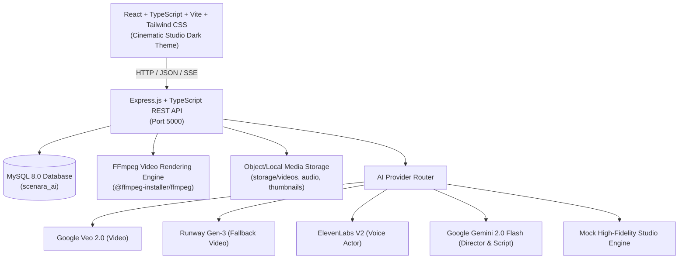

# SCENARA AI — Product Architecture & Documentation

## “From Script to Screen.”
**AI-Powered Filmmaking & Video Creation Studio**

---

## 1. Executive Summary

**SCENARA AI** is an AI-powered SaaS filmmaking platform that empowers creators, digital marketers, educators, and filmmakers to create complete cinematic films simply by providing an idea, script, or prompt.

Unlike simple chatbot-style generators, **SCENARA AI** functions as an **Autonomous Creative Studio** with an **AI Director** operating through an agentic pipeline:

```
IDEA / PROMPT ➔ AI DIRECTOR ➔ SCREENPLAY ➔ STORYBOARD ➔ SCENE GENERATION ➔ VOICE & ACTING ➔ SCORE & SFX ➔ MULTI-TRACK TIMELINE ➔ FFMPEG MASTER RENDER ➔ EXPORT
```

---

## 2. Technology Stack & System Architecture



### Frontend (`client/`)
- **Framework**: React 18 + TypeScript + Vite 5 + Tailwind CSS
- **Design Tokens**: Cinematic Studio palette (`#06080D`, `#0A0D14`, `#141A26`, `#1B2232`), neon cyan (`#00E5FF`), amber gold (`#F59E0B`), and royal purple (`#8B5CF6`).
- **Icons**: Lucide Icons
- **Responsive Layout**:
  - Desktop: 3-column pro studio workspace & timeline editor.
  - Mobile: Mobile-first bottom navigation drawer (`Home`, `Projects`, `Create`, `Assets`, `Profile`).

### Backend (`server/`)
- **Runtime**: Node.js + Express.js + TypeScript (`tsx`)
- **Database**: MySQL 8.0 via `mysql2/promise` connection pool
- **Video Assembly**: `fluent-ffmpeg` powered by `@ffmpeg-installer/ffmpeg`
- **Security**: JWT session tokens, bcrypt password hashing, input sanitization, and backend `.env` isolation.

---

## 3. Relational Database Design (MySQL)

All 14 specified relational tables are implemented in [schema.sql](file:///c:/laragon/www/SCENARA%20AI/server/src/database/schema.sql):

| Table Name | Description | Key Attributes |
| :--- | :--- | :--- |
| `users` | User credentials & plan status | `id`, `name`, `email`, `password_hash`, `plan`, `credits` |
| `projects` | Core film projects | `id`, `user_id`, `title`, `project_type`, `target_duration_seconds`, `aspect_ratio`, `status` |
| `project_settings` | Film camera & color directives | `duration`, `visual_style`, `camera_style`, `color_style`, `voice_style`, `music_style` |
| `scripts` | Screenplay drafts | `title`, `content` (Act I, II, III format), `ai_generated`, `version` |
| `characters` | Character consistency profiles | `name`, `age`, `gender`, `appearance`, `clothing`, `reference_image_url`, `voice_id` |
| `scenes` | Planned scene breakdown | `scene_number`, `duration_seconds`, `camera_angle`, `camera_movement`, `visual_prompt`, `dialogue`, `narration` |
| `scene_versions` | Scene version history | `version_number` (v1, v2, v3), `prompt`, `video_url`, `status` |
| `storyboards` | Concept art & keyframes | `scene_id`, `image_url`, `prompt` |
| `voices` | ElevenLabs voice library | `name`, `provider_voice_id`, `gender`, `language`, `style`, `preview_url` |
| `audio_assets` | Sound design stems | `type` (voice, music, sfx, ambience), `audio_url`, `duration` |
| `assets` | Uploaded media storage | `type` (image, video, audio), `file_url`, `mime_type`, `size` |
| `generation_jobs` | Asynchronous job queue | `job_type`, `provider`, `status`, `progress`, `started_at`, `completed_at` |
| `exports` | Rendered master video files | `format`, `resolution`, `aspect_ratio`, `file_url`, `duration` |
| `ai_usage` | Credit ledger & cost tracking | `provider`, `model`, `operation`, `units`, `estimated_cost` |

---

## 4. Flagship Showcase Project: "THE LAST CHANCE"

A complete 2-minute (120-second) cinematic drama pre-seeded into MySQL:

- **Protagonist**: *Andrian Pratama* (24 years old, fresh graduate in Jakarta).
- **Target Duration**: Exactly **120 Seconds** distributed across **8 Scenes**:
  - `SC 01`: *The Silent Dawn* (8s) — Contemplating rejection emails at dawn.
  - `SC 02`: *The Concrete Sea* (12s) — Striding through the morning crowds of Sudirman.
  - `SC 03`: *The Glass Corridor* (15s) — Sitting in the pristine corporate lobby.
  - `SC 04`: *The Boardroom Trial* (15s) — Declaring unyielding determination to the panel.
  - `SC 05`: *The Rainy Overpass* (18s) — Facing rain and heartbreak on a pedestrian overpass.
  - `SC 06`: *The Midnight Forge* (16s) — Building a revolutionary prototype in a night café.
  - `SC 07`: *The Breakthrough* (18s) — Presenting to senior executives and earning the handshake.
  - `SC 08`: *The Golden Call* (18s) — Calling his mother with tears of joy at sunset.
- **Total Duration Calculation**: `8 + 12 + 15 + 15 + 18 + 16 + 18 + 18 = 120 Seconds`.

---

## 5. Key Innovations & Modules

1. **Live Duration Distribution Breakdown**:
   - Choosing a target duration (10s, 30s, 60s, 90s, 120s, 300s, or Custom) dynamically computes the exact scene distribution and scene timing bars.
2. **Multi-Track Timeline Editor**:
   - `VIDEO TRACK`: Sequence of scene clips.
   - `VOICE TRACK`: Synchronized character dialogue & narration.
   - `MUSIC TRACK`: Continuous cinematic soundtrack (*Rise of Destiny*).
   - `SFX TRACK`: Layered ambient foley (*Rain, Traffic, Typing, Sub-bass Impact*).
3. **One-Click Video Repurposing (Section 75)**:
   - Convert a 120-second landscape video into 9:16 vertical TikTok/Shorts or 15s/30s promotional teasers.
4. **AI Scene Quality Assessment (Section 52)**:
   - Evaluates visual score, character consistency, prompt adherence, and audio balance with directorial recommendations.
5. **On-Set AI Co-Director Assistant (Section 76)**:
   - In-workspace floating assistant capable of updating dialogue, camera angles, and emotional tone in real-time.
6. **Provider Abstraction Layer**:
   - Safe isolation of Google Veo, Runway, ElevenLabs, and Gemini API keys with high-fidelity local dev fallback.
